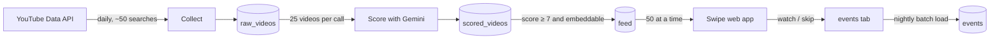

# FocusFeed

A swipe feed of YouTube Shorts about **one topic you choose**, so scrolling becomes study time. Mine is TOEFL. Yours can be anything.

Under the hood it's a small data pipeline. A daily job collects Shorts from the YouTube Data API, Gemini scores each one for relevance, and the results go through `raw → scored → feed` tables. A mobile web app serves the feed and logs what you watch or skip, and that feeds back into the pipeline. It runs entirely on free tiers, and anyone can run their own copy.

> **Status: Phase 1, in progress.** Done so far: Settings tab, Setup menu (spreadsheet tabs or BigQuery tables), tests, GitHub → Apps Script deploys, step 1 (daily collect), step 2 (Gemini scoring), step 3 (feed build), step 4 (the swipe web app) and step 5 (learning from likes, dislikes, watches and skips). Phase 1 is feature-complete; Phase 2 (Python + dbt) starts in January.

## How it works



| Step | What happens | Runs |
|---|---|---|
| 1. Collect | Searches YouTube for your topic (short, embeddable videos; the day's searches rotate through topic phrasings and sort orders) and fetches each video's duration, embeddability and stats. Stops early rather than exceed the daily quota | Daily trigger |
| 2. Score | Gemini rates each new feed-eligible video (embeddable, ≤ 3 min) 0–10 for how useful it is for learning the topic, 25 per call, with a one-line reason. Each video is scored once per prompt version. If a model is overloaded or out of quota it switches to the next model in `GEMINI_FALLBACK_MODELS`; scores are saved every 2 batches, and a run near Apps Script's 6-minute limit pauses and continues itself a minute later | An hour after collect |
| 3. Store | `raw_videos` → `scored_videos` → `feed`, plus `pipeline_runs` for monitoring | Each run |
| 4. Show | Swipe UI with embedded players. Opens on a phone with no login | On demand |
| 5. Learn | Likes and longer watches lift a channel in your feed, dislikes and quick skips lower it (at most ±2 points, so relevance still leads). New videos are scored with your liked / disliked titles in Gemini's prompt. With BigQuery, new events are batch-loaded into `events` every night | Page load / score run / ~02:00 |

Each step is a separate job. Phase 2 swaps steps 1–3 for Python, dbt and an orchestrator, and the UI stays the same.

## Two storage modes, one codebase

| | `sheets` (Lite, default) | `bigquery` |
|---|---|---|
| Needs | Only a Google account | A Google Cloud project (the free [BigQuery sandbox](https://cloud.google.com/bigquery/docs/sandbox) is enough, no card) |
| Where data lives | Tabs in the spreadsheet | Dataset `focus_feed`: tables partitioned by day and clustered by `video_id` |
| Limits | Oldest rows are pruned above `LITE_MAX_ROWS` to stay under the 10M-cell limit | Sandbox tables expire after 60 days unless you enable billing (see below) |

Both modes use one schema ([`Schema.gs`](apps-script/Schema.gs)), so switching modes means changing one setting and running Setup again.

## Set up your own copy

1. **Create the sheet and script.** Make a new Google Sheet, then open **Extensions → Apps Script**.
2. **Add the code.** Pick one way:
   - *Copy and paste:* in the editor, open **Project Settings** and tick *Show "appsscript.json"*. Then paste [`apps-script/appsscript.json`](apps-script/appsscript.json), and paste each `.gs` file from [`apps-script/`](apps-script) into a script file with the same name. The manifest turns on the YouTube and BigQuery services for you. You may want to change `timeZone` in the manifest, because daily jobs run on that clock.
   - *clasp:* `npm i -g @google/clasp`, `clasp login`, copy `.clasp.json.example` to `.clasp.json`, paste your Script ID into it (**Project Settings → IDs**), then run `clasp push`.
3. **Run Setup.** Reload the sheet and choose **FocusFeed → Setup**. Approve the permissions and type your topic. Setup creates the **Settings** tab and the data tabs.
4. **Add a Gemini key.** Create one at [aistudio.google.com/apikey](https://aistudio.google.com/apikey), ideally in a Cloud project **with no billing**, so it can never cost money. Then use **FocusFeed → Set Gemini API key…**. The key is checked, then stored in Script Properties. It never goes in the sheet or the code.
5. **(Optional) Use BigQuery.** In **Settings**, set `STORAGE` to `bigquery` and fill in `BQ_PROJECT_ID`, then run **Setup** again. It creates the dataset and tables.
6. **Check it.** **FocusFeed → Check setup** shows which Google account the script runs as, and whether the settings, tabs or tables, YouTube API and Gemini key all work.
7. **Collect.** Setup schedules the daily collect at `COLLECT_HOUR`. To fill the feed straight away, run **FocusFeed → Run collect now**: about a minute, roughly 5,000 YouTube units, and the result is a few hundred to a thousand-plus new rows in `raw_videos`.
8. **Score.** Setup also schedules scoring an hour after collect. Run **FocusFeed → Run score now** to score straight away; the summary shows the score spread plus the best and worst video so you can judge the model's taste.

> Keep the sheet, the script, the BigQuery project and the Gemini key on **one Google account**. Check setup shows which account the script runs as.

## Deploy the web app

1. In the Apps Script editor: **Deploy → New deployment → Select type: Web app**.
2. *Execute as:* **Me** · *Who has access:* **Anyone** → **Deploy**, and approve the permissions.
3. Open the **/exec** link (or **FocusFeed → Open feed**) on your phone. No login is needed; the page reads the feed through your script.
4. Optional: copy the **Deployment ID** into the GitHub variable `DEPLOYMENT_ID`, so every push to `main` updates the web app too.
5. **Add to Home screen** (Android Chrome: ⋮ → Add to Home screen) gives you the FocusFeed logo ([`assets/icon-512.png`](assets/icon-512.png)) and opens full-screen. To use your own logo, put a public https link to a square PNG in `APP_ICON_URL`. iPhones ignore page icons that Apps Script can set, so iOS shows a generic tile.

The page shows the best-scored videos first, one per screen, with Gemini's score and reason. Swipe up for the next one. What you watch (3 s or more) or skip is logged to the `events` tab, and those videos are hidden for 14 days. **Not for me** removes a video for good (with Undo); **Like** saves it, and liked videos come first when you replay the feed. Both are logged as events for the learning step.

## Settings

Everything is configured in the **Settings** tab. Setup adds any new settings without overwriting your values.

| Key | Default | Meaning |
|---|---|---|
| `TOPIC` | (asked on first Setup) | The one topic your feed is about |
| `SEARCH_TERMS` | | Optional extra search phrases, comma-separated. Leave blank to build searches from `TOPIC` |
| `SEARCH_LANGUAGE` | `en` | Language for YouTube search results |
| `SEARCHES_PER_DAY` | `50` | 100 quota units each, out of 10,000 a day. Maximum is 90 |
| `COLLECT_HOUR` | `14` | Hour of the daily collect, in the script's time zone. YouTube's quota resets at midnight Pacific (about 13:30 in India) |
| `MIN_SCORE` | `7` | Lowest Gemini score (0–10) that reaches the feed |
| `MAX_VIDEO_AGE_DAYS` | `0` | Only videos published in the last N days (730 = 2 years); also narrows searches. 0 = any age |
| `LANGUAGE_FILTER` | | e.g. `en`: only videos in that language (YouTube's audio language where known; Gemini checks the rest) |
| `EXCLUDE_ADS` | `yes` | Videos that mainly advertise a course, coaching, app or discount score 2 or less |
| `SCORING_GUIDANCE` | | Your own rules for Gemini in plain words. Changing it (or the two rows above) re-scores every video once |
| `SCORE_BATCH_SIZE` | `25` | Videos per Gemini call |
| `GEMINI_MODEL` | `gemini-flash-latest` | An alias for the newest Flash model. Put a specific model name here to pin one |
| `GEMINI_FALLBACK_MODELS` | `gemini-flash-lite-latest, gemini-2.5-flash` | Tried in order when the main model is overloaded, rate-limited, out of daily quota or not found. `none` turns fallback off |
| `FEED_PAGE_SIZE` | `50` | Videos the web app loads at a time |
| `STORAGE` | `sheets` | `sheets` or `bigquery` |
| `LITE_MAX_ROWS` | `100000` | Sheets mode only: row cap per data tab |
| `BQ_PROJECT_ID` | | BigQuery mode only: Cloud project **ID** |
| `BQ_DATASET` | `focus_feed` | BigQuery mode only: dataset name |
| `BQ_LOCATION` | `US` | BigQuery mode only: dataset location, which can't change after creation |
| `BQ_SANDBOX_EXPIRY` | (set by Setup) | When sandbox tables will be deleted |

## BigQuery sandbox: what to know

- **Sandbox-safe by design.** Tables are created through the API, and data only arrives through **batch load jobs**. Nothing uses DML or streaming inserts, which the sandbox doesn't allow.
- **The 60-day clock.** Sandbox tables and partitions are deleted 60 days after creation. Setup reads the real expiration times and schedules a reminder email **15 days before** (day 45). The sheet also shows a notice when you open it in the last 15 days.
- **To keep your data:** enable billing on the project (the free tier of 10 GB storage and 1 TB of queries a month still applies). Then remove the dataset's default expiration and each table's expiration and partition expiration ([guide](https://cloud.google.com/bigquery/docs/sandbox)), and run **Setup** again. Setup re-checks the tables and stops the reminder once nothing expires.

## Quotas and cost

| Service | Free allowance | FocusFeed uses |
|---|---|---|
| YouTube Data API | 10,000 units a day | 50 searches × 100 units, plus about 1 unit per 50 video lookups. Roughly 5,100 a day |
| Gemini API | Free tier on a no-billing project | About 2,500 videos a day ÷ 25 per call. Roughly 100 calls a day |
| BigQuery | Sandbox, or the free tier after billing | A few MB a day |
| Apps Script | Consumer account limits | One daily job and one nightly job |

## Deploy from GitHub (optional)

[`.github/workflows/deploy.yml`](.github/workflows/deploy.yml) runs the tests on every push and pull request. On a push to `main` it runs `clasp push` (pinned to `@google/clasp@3.4.1`).

To enable it, open **Settings → Secrets and variables → Actions** in your repo or fork and add:

| Name | Type | Value |
|---|---|---|
| `CLASPRC_JSON` | Secret | Contents of `~/.clasprc.json` after `clasp login` (on Windows: `%USERPROFILE%\.clasprc.json`). Log in with the account that owns the script |
| `SCRIPT_ID` | Variable | Apps Script → **Project Settings → Script ID** |
| `DEPLOYMENT_ID` | Variable, optional | Your web app deployment ID. Each deploy then moves the web app to the new code |

Without the first two, the deploy job is skipped and the tests still run.

`CLASPRC_JSON` works like a password for your Apps Script projects. If it ever leaks, remove **clasp – The Apps Script CLI** at [myaccount.google.com/connections](https://myaccount.google.com/connections), run `clasp login` again and update the secret. With `DEPLOYMENT_ID` set, every deploy creates a script version. Apps Script keeps a limited number of versions, so delete old ones under **Deploy → Manage deployments** now and then.

## Development

```text
apps-script/
  appsscript.json   manifest: V8, YouTube + BigQuery advanced services, scopes, web app access
  Config.gs         Settings tab: definitions, defaults, validation
  Schema.gs         table definitions shared by both storage modes
  SheetsStore.gs    sheets backend
  BigQueryStore.gs  BigQuery backend (create, additive migrations, expiry status)
  Pipeline.gs       shared plumbing: run IDs, storage-agnostic appends, pipeline_runs log, YouTube quota budget
  Collect.gs        step 1: rotating searches → video details → raw_videos
  Gemini.gs         Gemini client: JSON-schema output, retries, rate-limit handling
  Score.gs          step 2: unscored candidates → Gemini in batches → scored_videos
  Feed.gs           step 3: latest score ≥ MIN_SCORE → feed; step 4: doGet, getFeedPage, logEvents
  Learn.gs          step 5: viewer signals, channel boost, taste profile for scoring, nightly events load
  Index.html        the swipe page: scroll-snap cards, YouTube IFrame API player, event logging
  Setup.gs          FocusFeed menu: Setup, Gemini key, Run collect/score now, Build feed now, Open feed, Check setup, sandbox reminder
tests/gas.test.js   runs the real .gs files against in-memory fakes of Google services
```

Run `npm test` (Node 20 or later, no install needed). Schema changes are **additive only**: add columns at the end, and Setup adds them to existing tabs and tables as `NULLABLE`.

## Roadmap

- **Phase 1 (now):** collect → score → feed in Apps Script, the swipe web app, a nightly `events` load, and pruning for Lite mode.
- **Phase 2 (January 2027):** Python, dbt and GitHub Actions or Airflow replace steps 1–3. The UI stays the same.

## License

[MIT](LICENSE)
